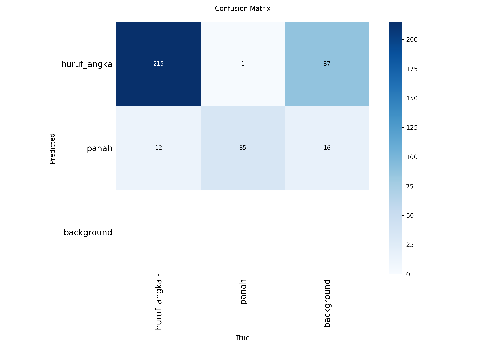

# Praktik Terpadu YOLO: Joel Mark Rodrigo Purba (4222401008)

## Dataset
- Sumber: Roboflow Universe, image-detection-qixfs v9 (deteksi huruf/angka dan panah)
- 2 kelas: `huruf_angka`, `panah`. Dibagi per sesi foto (anti kebocoran) dengan proporsi sekitar 70/20/10.
- Model dasar: `yolo26n`, epoch 30, imgsz 416. Perubahan E3: `imgsz=640`.

## Hasil eksperimen (data VAL)
| eksperimen    | perubahan   | pretrained   |   mAP50 |   mAP50-95 |   precision |   recall |   inferensi_ms |   waktu_latih_menit |   imgsz |
|:--------------|:------------|:-------------|--------:|-----------:|------------:|---------:|---------------:|--------------------:|--------:|
| E1_pretrained | -           | True         |  0.995  |     0.9485 |      0.9851 |   0.9979 |           2.58 |                5.76 |     416 |
| E2_scratch    | -           | False        |  0.9945 |     0.9212 |      0.9919 |   0.9817 |           2.36 |                5.63 |     416 |
| E3_tuning     | imgsz=640   | True         |  0.995  |     0.9447 |      0.9959 |   0.9992 |           5.29 |                7.93 |     640 |

## Hasil uji (data TEST, sekali saja)
- Model terpilih (mAP50-95 val tertinggi): E1_pretrained
- Hasil di data TEST (sekali saja)       : mAP50 0.995 | mAP50-95 0.944

## Analisis

### 1. Ringkasan
Praktik ini membandingkan tiga eksperimen YOLO (model `yolo26n`, 2,39 juta parameter) untuk mendeteksi objek huruf/angka dan panah. Model pretrained (E1) menjadi yang terbaik dengan mAP50-95 0,949 pada data validasi dan 0,944 pada data test. Model tanpa transfer learning (E2) mencapai 0,921, sedangkan perubahan ukuran gambar menjadi 640 (E3) tidak memberi peningkatan (0,945) dan membuat inferensi dua kali lebih lambat.

### 2. Dataset dan pengaturan
Dataset berasal dari Roboflow Universe (image-detection-qixfs, versi 9) dengan 1.311 gambar berukuran 416×416, masing-masing berisi satu objek. Terdapat dua kelas: `huruf_angka` (1.132 gambar, gabungan 25 jenis huruf/angka berbeda warna) dan `panah` (179 gambar, empat arah/warna). Kondisi cahaya terdiri dari 983 terang, 301 redup, dan 27 gelap. Data dibagi per sesi foto dengan proporsi sekitar 70/20/10:

| Bagian | Gambar | huruf_angka | panah | Sesi foto |
|---|---|---|---|---|
| train | 917 | 792 | 125 | 162 |
| val | 263 | 227 | 36 | 113 |
| test | 131 | 113 | 18 | 108 |

Pembagian per sesi memastikan tidak ada sesi yang terpisah antara bagian train, val, dan test, sehingga gambar yang hampir kembar tidak bocor ke data uji. Seluruh eksperimen memakai pengaturan yang sama (30 epoch, batch 16, imgsz 416, seed 0, GPU Tesla T4), kecuali yang sengaja diubah pada E2 (tanpa bobot pretrained) dan E3 (imgsz 640).

### 3. Cara membaca metrik
mAP50 menghitung ketepatan deteksi dengan syarat kotak prediksi tumpang tindih minimal 50% dengan kotak sebenarnya, sedangkan mAP50-95 merata-ratakan ketepatan pada ambang tumpang tindih 50% sampai 95% sehingga menuntut kotak yang jauh lebih presisi. Pada dataset ini mAP50 semua eksperimen sudah jenuh di sekitar 0,995 (E2 0,9945), sehingga tidak bisa lagi membedakan model. Karena itu mAP50-95 dijadikan penentu pemilihan model, sedangkan precision dan recall dipakai sebagai pelengkap.

### 4. E1 (pretrained) vs E2 (scratch)
Pada data validasi, E1 mencapai mAP50-95 0,949 dan E2 0,921, selisih sekitar 0,028. Perbedaan yang lebih mencolok terlihat pada kecepatan belajar. Dari log pelatihan, E1 sudah mencapai mAP50-95 sekitar 0,65 pada epoch 1 dan melewati 0,90 pada epoch 8. E2 hampir nol pada epoch 1 (0,0003), baru sekitar 0,30 pada epoch 5, dan baru melewati 0,90 pada epoch 26. Nilai loss juga mendukung hal ini: pada epoch 30, box loss E1 sebesar 0,555 dan cls loss 0,195, sedangkan E2 masih 0,735 dan 0,423. Artinya E2 belum sepenuhnya konvergen dalam 30 epoch, dan dugaan saya selisihnya dapat mengecil bila E2 dilatih lebih lama (belum diuji).

Penyebabnya adalah transfer learning. Bobot pretrained dari COCO sudah memuat fitur visual dasar seperti tepi, sudut, warna, dan bentuk, sehingga E1 hanya perlu menyesuaikan diri ke dua kelas baru. E2 harus mempelajari seluruh fitur itu dari nol hanya dari sekitar 900 gambar latih. Pada precision dan recall, E1 (P 0,985; R 0,998) lebih unggul pada recall dibanding E2 (P 0,992; R 0,982), artinya E2 sedikit lebih sering melewatkan objek. Waktu latih dan kecepatan inferensi kedua model hampir sama (5,8 vs 5,6 menit; 2,6 vs 2,4 ms) karena arsitekturnya identik.

### 5. E3 (tuning imgsz=640)
Perubahan tunggal pada E3 adalah ukuran gambar masukan dari 416 menjadi 640. Hasilnya mAP50-95 0,945, sedikit di bawah E1 (0,949), dengan precision 0,996 dan recall 0,999. Harganya nyata: waktu inferensi naik dari 2,6 ms menjadi 5,3 ms (sekitar dua kali lipat) dan waktu latih dari 5,8 menjadi 7,9 menit. Hal ini wajar karena gambar asli dataset berukuran 416×416, sehingga memperbesarnya hanya menginterpolasi piksel tanpa menambah detail baru, sementara jumlah komputasi naik sekitar 2,4 kali lipat (rasio luas gambar 640² terhadap 416²).

Selisih mAP50-95 sebesar 0,004 sangat kecil dan berasal dari satu kali percobaan, sehingga tidak cukup untuk menyimpulkan E3 pasti lebih buruk. Kesimpulan yang dapat ditarik adalah memperbesar imgsz tidak memberi keuntungan yang sepadan dengan biayanya pada dataset ini. Precision E3 sedikit lebih tinggi daripada E1 (0,996 vs 0,985), namun selisihnya kecil dan tidak mengubah kesimpulan.

### 6. Pemilihan model, hasil uji, dan kelas yang sulit
Model dipilih berdasarkan mAP50-95 tertinggi pada data validasi, yaitu E1 (0,949). Model ini kemudian diuji satu kali pada data test dan memperoleh mAP50 0,995 serta mAP50-95 0,944. Nilai test hampir sama dengan validasi (0,944 vs 0,949), sehingga tidak ada tanda overfitting dan model menggeneralisasi dengan baik ke gambar dari sesi foto yang belum pernah dilihat. Data test hanya dipakai sekali agar tidak ikut memengaruhi pemilihan model.

**Kelas yang sulit.** Confusion matrix E1 pada data validasi (263 objek: 227 `huruf_angka` dan 36 `panah`) ditampilkan di bawah ini.

Sebanyak 215 dari 227 objek `huruf_angka` (94,7%) dan 35 dari 36 objek `panah` (97,2%) terdeteksi dengan kelas yang benar, dan tidak ada objek yang terlewat (baris `background` kosong). Kesalahan klasifikasi sangat sedikit: 12 objek `huruf_angka` terbaca sebagai `panah` (5,3%) dan hanya 1 objek `panah` terbaca sebagai `huruf_angka` (2,8%). Kelas `huruf_angka` lebih sering salah dibanding `panah` meskipun jumlah datanya jauh lebih banyak. Dugaan penyebabnya adalah beberapa huruf atau angka bentuknya menyerupai panah, tetapi hal ini belum diperiksa pada gambar hasil prediksi. Kesalahan terbanyak justru berupa prediksi berlebih: ada 103 kotak yang tidak sesuai dengan objek mana pun (87 berlabel `huruf_angka` dan 16 berlabel `panah`). Artinya model lebih cenderung menghasilkan kotak tambahan daripada melewatkan objek. Perlu dicatat bahwa jumlah ini dihitung pada ambang kepercayaan tertentu pada pembuatan matriks, sehingga dapat berbeda dari nilai precision dan recall di tabel.

Kelas `panah` hanya memiliki 179 gambar dibandingkan 1.132 gambar `huruf_angka` (36 vs 227 objek di data validasi, dan hanya 18 gambar di data test), sehingga angkanya kurang stabil dan satu kesalahan saja dapat menggeser persentasenya. Selain itu, sekitar seperempat objek hanya menempati sekitar 1,2% luas gambar, sehingga objek kecil menjadi tantangan bagi ketepatan kotak. Kelas `huruf_angka` juga menggabungkan 25 jenis huruf/angka menjadi satu kelas, sehingga model tidak perlu membedakan antar huruf; tugas ini lebih mudah daripada mengenali tiap huruf secara terpisah.

### 7. Keterbatasan dan saran
- **mAP50 sudah jenuh** di sekitar 0,995 sehingga tidak lagi membedakan model. Diperlukan data yang lebih sulit, misalnya latar yang rumit, objek yang berdempetan, dan lebih banyak gambar cahaya gelap (hanya 27 dari 1.311 gambar).
- **Satu objek per gambar** membuat tugas lebih mudah dari kondisi nyata, dan hasil ini belum menunjukkan kemampuan model pada gambar dengan banyak objek.
- **Prediksi berlebih (false positive).** Confusion matrix menunjukkan 103 kotak tanpa objek yang sesuai. Penyebabnya perlu diselidiki lebih lanjut (kotak ganda pada objek yang sama atau deteksi pada benda lain), misalnya dengan memeriksa gambar prediksi dan menaikkan ambang kepercayaan (confidence) saat inferensi.
- **Ketimpangan kelas** (panah jauh lebih sedikit) dan jumlah panah yang kecil di data test membuat evaluasi kelas ini kurang andal.
- **Satu kali percobaan per eksperimen.** Selisih kecil seperti E1 vs E3 (0,004) belum bisa dipastikan nyata. Sebaiknya diulang dengan beberapa seed dan dilaporkan rata-rata serta simpangannya.
- **Eksperimen tuning lain** seperti menambah epoch (misalnya 60) atau augmentasi lebih menjanjikan daripada memperbesar ukuran gambar, karena E2 masih terlihat belum konvergen dan citra asli hanya 416×416.

### 8. Kesimpulan
Transfer learning terbukti mempercepat konvergensi dan memberi mAP50-95 yang lebih tinggi dibanding melatih dari nol (0,949 vs 0,921). Memperbesar ukuran gambar menjadi 640 tidak memberi keuntungan dan hanya menambah beban komputasi. Model E1 dipilih dan memberi hasil test mAP50 0,995 dan mAP50-95 0,944 dengan kecepatan inferensi sekitar 2,6 ms per gambar, cukup untuk penggunaan waktu nyata pada dataset ini.
